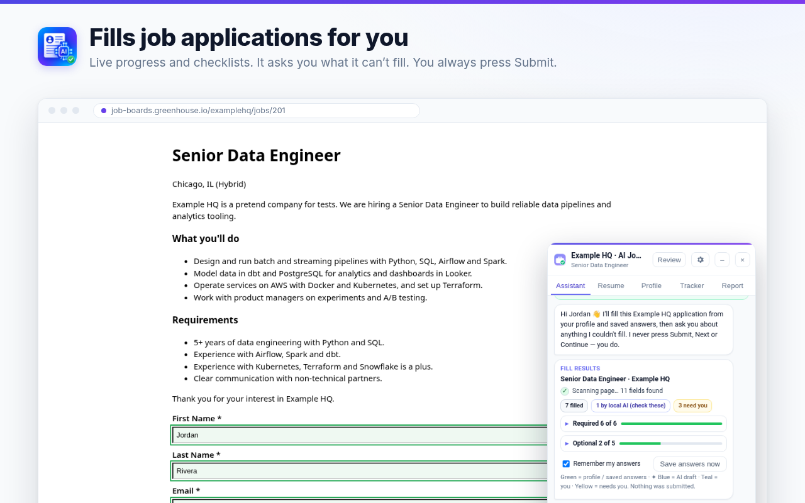
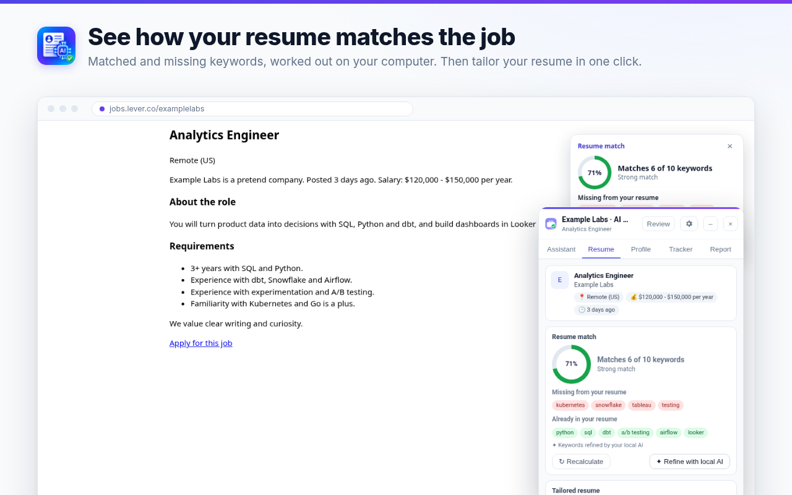
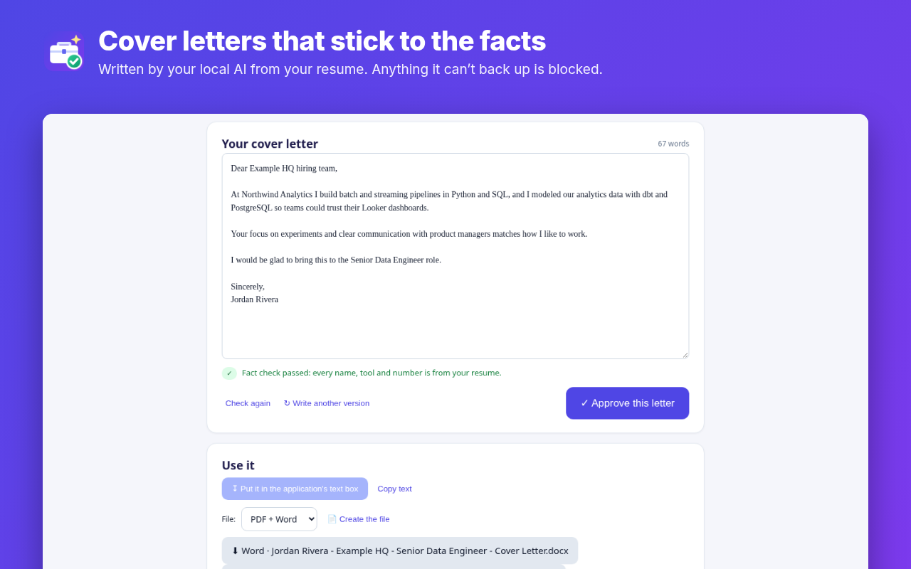
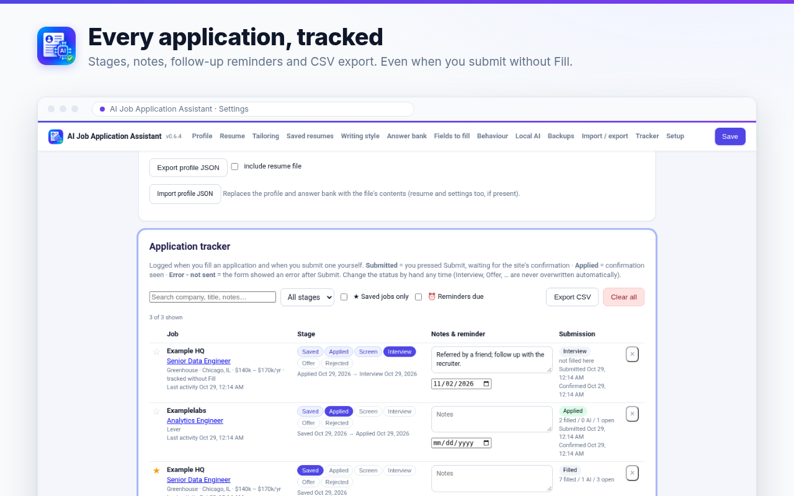

<p align="center"></p>

<h1 align="center">AI Job Application Assistant</h1>

<p align="center"><b>Free AI job application autofill that keeps your resume on your computer.</b><br>
Autofill job applications, draft answers, tailor your resume and write cover letters with AI that runs locally.<br>
No account. No subscription. No in-app purchases. It never clicks Submit.</p>

<p align="center">
<a href="https://chromewebstore.google.com/detail/ai-job-application-assist/ianfkblcpiejjcjammkdloflpjhodaen?utm_source=github&utm_medium=readme&utm_campaign=evergreen"></a>
<a href="LICENSE"></a>


<a href="https://github.com/aridawoodi/job-apply-assistant/stargazers"></a>
</p>

<p align="center">
<a href="https://chromewebstore.google.com/detail/ai-job-application-assist/ianfkblcpiejjcjammkdloflpjhodaen?utm_source=github&utm_medium=readme&utm_campaign=evergreen"><b>➜ Add to Chrome (free)</b></a> ·
<a href="https://aridawoodi.github.io/job-apply-assistant/">Website</a> ·
<a href="PRIVACY.md">Privacy</a> ·
<a href="docs/USER-GUIDE.md">User guide</a>
</p>

<p align="center"></p>

> **Looking for the right extension?** Other Chrome extensions have similar names, and some sell paid features.
> This one is made by **Ari Dawoodi**, is **100% free**, **MIT open source**, has **no in-app purchases**, and its
> Chrome Web Store ID is `ianfkblcpiejjcjammkdloflpjhodaen`.

## Why it exists

Most job application tools give autofill away and charge for the AI writing, because cloud AI costs them money on
every request. This extension runs the AI **on your own computer** (Chrome's built-in AI or the free
[Ollama](https://ollama.com) app), so every feature is free and your resume never goes to a server.

## Features

- ⚡ **Autofills job applications** on Greenhouse, Lever and Ashby (plus basic Workday and LinkedIn Easy Apply) from a profile built from your PDF or Word resume.
- 🎨 **Colour-codes every field**: from your profile, drafted by AI, typed by you, or still needs you.
- 💬 **Drafts answers** to open questions ("Why do you want to work here?") in your voice, and asks you one question at a time about anything it couldn't fill.
- 📄 **Tailors your resume** to each job by rewording and reordering what's already true. Invented employers, titles, dates, numbers and tools are blocked, and you approve every change. Word or PDF.
- ✉️ **Writes cover letters**, fact-checked the same way.
- 🎯 **Shows your resume match**: the job's keywords you cover and the ones you're missing.
- 📋 **Tracks applications** with stages, notes, follow-up reminders and CSV export.
- 🛑 **Never presses Submit, Next or Apply.** Equal-opportunity (EEO) questions are never filled by AI.

| Resume match | Cover letters | Application tracker |
|---|---|---|
|  |  |  |

## Privacy

Everything (profile, resume, answers, tracker, cover letters) is stored only in your browser. The AI runs on your
device. There is no account, no server, no analytics and no remote code. EEO answers and salary are never sent to
the AI. Details: [PRIVACY.md](PRIVACY.md).

## How it compares

Free tiers, from each tool's own website, checked October 31, 2026. Prices and limits change, so check their sites.

| | Free autofill | Free AI answers, tailoring, cover letters | Account | Your data leaves your computer |
|---|---|---|---|---|
| **AI Job Application Assistant** | ✅ Unlimited | ✅ Unlimited, local AI | ✅ None | ✅ No |
| [Simplify Copilot](https://help.simplify.jobs/articles/5623502-whats-included-in-simplify-features-and-pricing) | ✅ | Simplify+ ($19.99/week, $39.99/month or $89.99/3 months) | Required | Yes |
| [DonutApply](https://donutapply.com/) | ✅ Unlimited, one at a time | Free allowance, then Pro | Required (US) | Yes (cloud AI) |
| [VeloApply](https://veloapply.com/pricing) | ✅ On supported forms | Limited allowance; $19–$99/month | Required | Yes (cloud AI) |
| [ApplyBtn](https://applybtn.app/) | ✅ | 1,000 welcome credits, then paid | Required | Yes (cloud AI) |

Bigger tools support more sites and include job search; this one is free, private and open source.
Full table and notes: [https://aridawoodi.github.io/job-apply-assistant/#compare](https://aridawoodi.github.io/job-apply-assistant/#compare).

## Install

1. **[Add it from the Chrome Web Store](https://chromewebstore.google.com/detail/ai-job-application-assist/ianfkblcpiejjcjammkdloflpjhodaen?utm_source=github&utm_medium=readme&utm_campaign=evergreen)** (free).
2. A setup page opens. Import your resume (PDF or Word) and check what it found.
3. Try it on the built-in practice application, then on a real one: click **⚡ Fill application**.
4. Set up the local AI when you want drafted answers, tailoring and cover letters. The setup page detects Chrome's
   built-in AI (Chrome 138+, roughly 16 GB of memory or a strong GPU) or walks you through Ollama (8 GB of memory is
   enough, about 3 GB of disk). No terminal needed.

## FAQ

**Is it really free?** Yes. No paid plan, credits, trial or in-app purchases. The AI runs on your computer, so there's no server bill.

**Does my resume leave my computer?** No. It's stored in your browser, and the AI runs locally.

**Which sites?** Best on Greenhouse, Lever and Ashby; basic Workday and LinkedIn Easy Apply; one-click profile copy anywhere.

**Do I need Ollama?** Only if Chrome's built-in AI isn't available on your computer. Setup tells you which to use.

**Does it submit for me?** Never. You review and press Submit.

**Is it the same as other extensions with similar names?** No. See the note at the top.

## Contributing

Bug reports, site requests and pull requests are welcome. See [CONTRIBUTING.md](CONTRIBUTING.md) and
[open an issue](https://github.com/aridawoodi/job-apply-assistant/issues). If a form on a job site doesn't fill
properly, the panel's **Report** tab prepares a report with no personal data.

**If it saved you time, please ⭐ star the repo and [leave a review on the Chrome Web Store](https://chromewebstore.google.com/detail/ai-job-application-assist/ianfkblcpiejjcjammkdloflpjhodaen/reviews?utm_source=github&utm_medium=readme&utm_campaign=evergreen).** It's a one-person project, and both help other job seekers find it.

---

## Using it

### What you'll see
- **Toolbar icon:** colored on job pages it supports, gray elsewhere. Hover it to see what it found.
- **The panel** has five tabs. **Assistant** shows live fill progress and Required/Optional checklists.
  **Resume** has the match score, *Improve my match* and the cover letter. **Profile** is click-to-copy.
  **Tracker** has the stage, notes and reminder for this job. **Report** is for problems and site requests.
- **On job postings** a small match card shows how well your resume fits. You can dismiss it or turn it off
  in Settings.
- **Settings → Fields** turns individual fields or whole groups off, for example all EEO questions.
  **Settings → Behaviour** has the application email, auto-open, the match card, the Refine toolbar,
  tracking without Fill and more.

### Cover letters
On an application, open **Resume → ✍️ Write a cover letter with my resume** (or *Write it from my resume* on a cover-letter
question). The local AI drafts the letter. Anything it can't back up from your resume is blocked:
numbers and tools you don't have. Terms that only appear in the job description are flagged. Approve the
letter, then put it in the text box or export a PDF or Word file named
`First Last - Company - Job Title - Cover Letter` and attach it.

### Tailor your resume for a job
On a job application, open the assistant chat and type **"tailor my resume for this job"** (or click
*📄 Tailor my resume* in the review). A page opens with suggested changes, each fact-checked against your
resume. Tick the ones you like, choose PDF, Word or both, and download. One click attaches it to the
application. Add your own rules in **Settings → Tailoring**, e.g. "Keep to 2 pages", "Use US spelling",
"Don't change job titles". Tailored resumes are saved in **Settings → Saved resumes**.

If your master resume is a **Word file**, your own file is edited in place, so the layout stays exactly as
you designed it. If it's a **PDF**, a clean resume with the same structure is rebuilt; it is close to your
original but not identical. Uploading the Word version gives the best result.

### What you need
- Google Chrome 110 or newer (or another Chromium browser such as Edge or Brave) on macOS or Windows.
  Linux works too. Chrome 138+ gives you built-in AI (Gemini Nano) at no extra setup.
- For Ollama: about 3 GB of free disk space for Ollama and the small AI model (about 6 GB for the larger one). 
  8 GB of memory is enough; with 16 GB or more the setup suggests a larger model that writes better.
- For Chrome built-in AI: Chrome 138+, and about 16 GB RAM or a strong GPU. 8 GB machines work better with Ollama.

## Help
| Problem | Fix |
|---|---|
| Setup says "Waiting for Ollama…" | Install Ollama with the button on the setup page and open it. On Mac it shows a llama in the menu bar; on Windows, in the taskbar tray. |
| "Ollama is running, but it refused the connection" | Click **Try the automatic fix**. If that doesn't help, follow the one-time manual steps shown right below it. |
| AI answers are slow | The first answer loads the model (up to a minute). Use the recommended model (Settings → Local AI), close heavy tabs. |
| A field stayed yellow | It needs you: fill it on the page or answer it in the chat. |
| I lost my data after reinstalling | Settings → Backups → **Restore from file**. Never click "Remove" on the extension without a backup file. |

More: [User guide](docs/USER-GUIDE.md) · [Windows notes](docs/WINDOWS.md) · [Changelog](CHANGELOG.md)

---

## Developers

Plain JavaScript, Manifest V3, no build step, no frameworks, no remote code. Third-party libraries are
vendored in `lib/vendor/` (pdf.js, JSZip, jsPDF; see `lib/vendor/README.md`).

### Install from source
1. Download or clone this repository.
2. Open `chrome://extensions`, switch on **Developer mode**, click **Load unpacked**, pick the folder that
   contains `manifest.json`.
3. The setup page opens. After changing code, click the reload icon on the extension card and reload
   open job tabs (your data is kept).

### How the "no terminal" Ollama connection works
Ollama rejects requests whose `Origin` header isn't a local address, and Chrome sends
`Origin: chrome-extension://<id>` on the extension's POST requests, so normally users have to set
`OLLAMA_ORIGINS` in a terminal. Instead, the extension installs a **declarativeNetRequest** rule (see
`installOriginRules` in `background.js`) that removes the `Origin` header **only** on requests the
extension itself makes (`initiatorDomains: [<extension id>]`) to the configured local Ollama address.
Web pages are not affected, so Ollama still blocks websites. Tested against Ollama 0.40.6. The setup
page keeps a manual `OLLAMA_ORIGINS` fallback for unusual setups.

### Layout
```
manifest.json            MV3 manifest
background.js            service worker: Ollama calls, Origin rule, model download, resume tasks, sessions, backups, tracker
lib/defaults.js          default settings, profile schema, storage loader (shared)
lib/resume.js            PDF/DOCX parsing (local), regex facts, model-output validation, profile mapping
lib/extract.js           resume sections/entries by rules, per-section AI prompts, validation + merge
lib/tailor.js            tailoring prompt, fact validation, rules, file names
lib/cover.js             cover-letter prompt, fact checks, file name
lib/match.js             resume ↔ job keyword match (local)
lib/docx.js              in-place DOCX editing + DOCX template builder
lib/pdfout.js            PDF builder (jsPDF)
lib/importer.js          resume import + editable review screen (setup wizard and Settings)
lib/pageutil.js          helpers for extension pages; lib/pages.css shared styles
lib/vendor/              pdf.js, JSZip, jsPDF (with licenses)
content/                 content scripts: field detection, site adapters, chat panel + tabs (panel.js), refine toolbar,
                         match card, multi-step, learning, tracking
onboarding/              first-run setup wizard
tailor/                  tailor-my-resume page (diff / approve / export / attach)
cover/                   cover-letter page (draft / fact check / approve / fill or attach)
privacy/                 bundled privacy page
practice/                practice application + guided tour (demo person, nothing is sent or saved)
options/  popup/         settings page and toolbar popup
store/                   Chrome Web Store listing text, permission justifications
store-assets/            store tile and screenshots (fake data)
scripts/                 lint + build-zip scripts, site.py (builds the homepage)
site/                    homepage for GitHub Pages (static HTML/CSS, generated by scripts/site.py)
dev-tests/               Playwright end-to-end tests, mocks, fixtures (not shipped)
```

### Tests
```bash
cd dev-tests && npm i playwright && npx playwright install chromium
node unit-v4.js                              # pure helpers, no browser
node unit-v6.js                              # v0.6 resume import (sections, schools, jobs, projects, skills), no browser
node unit-rating.js                          # v0.6.4 optional rating prompt (when it shows, buttons, what counts), no browser
node e2e-rating.js                           # v0.6.4 rating prompt in the browser (popup card, buttons, Settings link)
node e2e-v4.js                               # setup wizard, Origin rule, model pull, resume import, tailoring (mock Ollama)
node e2e-v5.js                               # v0.5: tour, icon, progress, refine, tabs, match, cover letters, tracking, settings (ONLY=match,cover,...)
node e2e-live-v5.js                          # live Greenhouse/Lever/Ashby, fill only (non-GET requests aborted) + performance numbers
OLLAMA_URL=http://127.0.0.1:11434 node e2e-real-ollama.js   # against a real Ollama + model
```
Older suites (`e2e-v3.js`, `e2e-steps.js`, `e2e-ai.js`, `e2e-submit.js`, `test-mocks.js`) are described
in `dev-tests/README.md`. All test data is made up.

### Performance
Content scripts are plain JS (no framework). Heavy libraries (pdf.js, JSZip, jsPDF) load only when a page
needs them. Observers are debounced, and the match card waits until the browser is idle.
`dev-tests/e2e-live-v5.js` measures the extension's own CPU time on live pages (CDP sampling profiler,
`chrome-extension://` frames) and compares page metrics with and without the extension. Results for
v0.5.0 are in the CHANGELOG release notes and `dev-tests/perf-v5.json`.

### Build the store zip
```bash
node scripts/lint.js && python3 scripts/build.py     # -> dist/job-apply-assistant-v<version>.zip
```

Contributions are welcome: see [CONTRIBUTING.md](CONTRIBUTING.md). License: [MIT](LICENSE).

### Website
The homepage in `site/` is plain HTML and CSS (no JavaScript, no trackers). Edit `scripts/site.py`, run `python3 scripts/site.py`, and `.github/workflows/pages.yml` publishes it to GitHub Pages on push to `main`.
